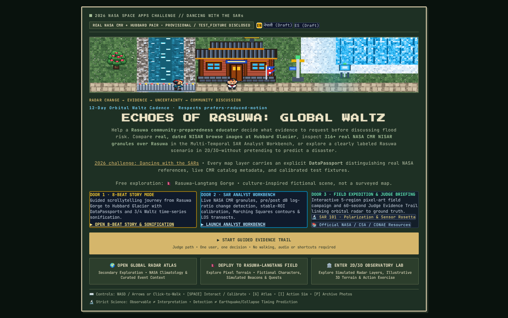
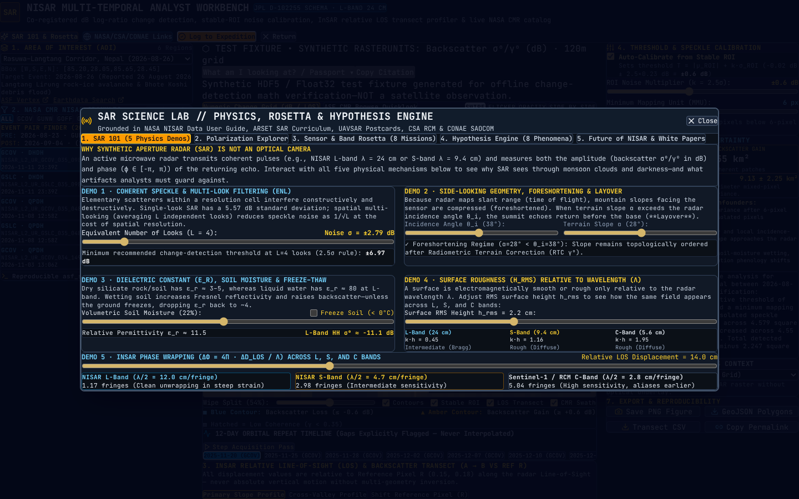
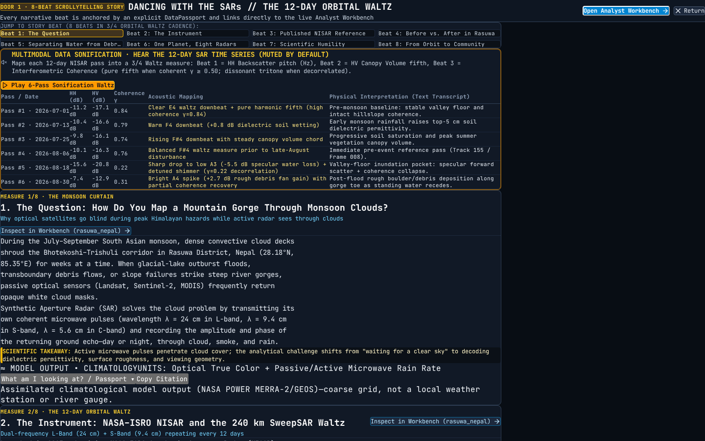
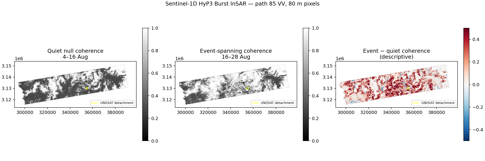
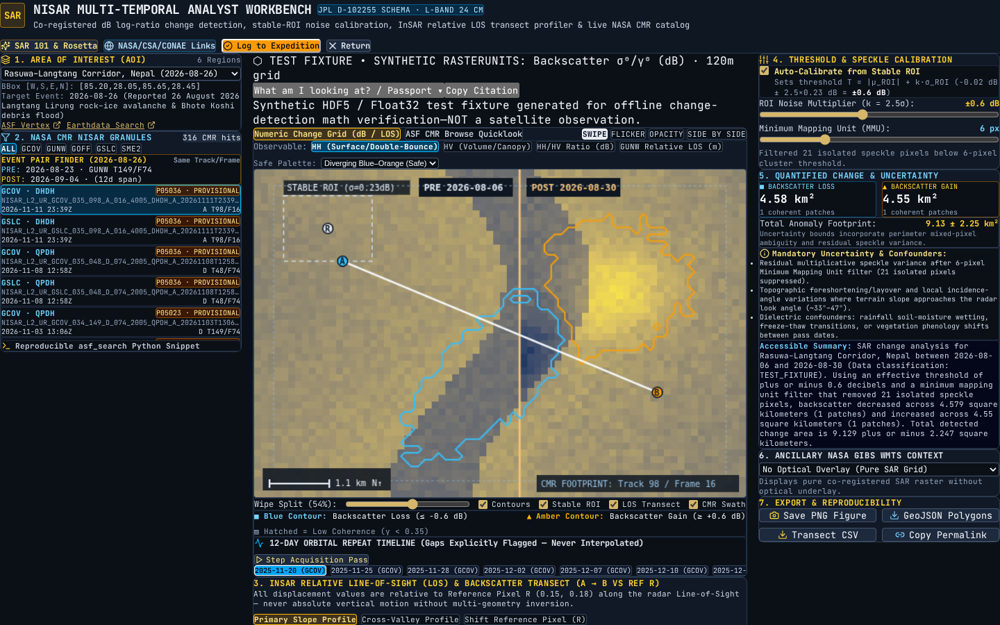
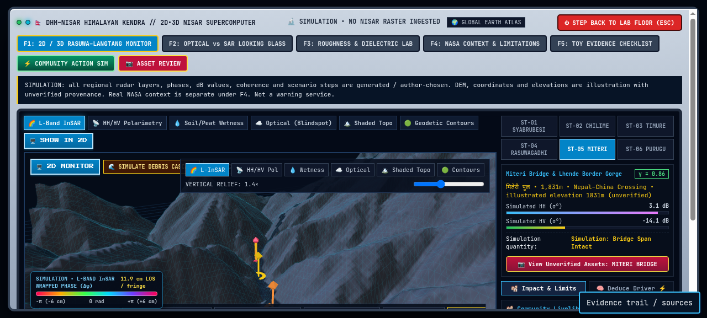

# Slide 1: Echoes of Rasuwa: Global Waltz
### Character-Led SAR Storytelling, Empirical Rasuwa Research & Multi-Temporal Workbench
- **Challenge:** 2026 NASA Space Apps Challenge — *Dancing with the SARs*
- **Team Name:** `[YOUR TEAM NAME]`
- **Team Members:** `[TEAM MEMBER NAMES & ROLES]`
- **Core Rule:** Every map, chart, and photo carries a strict **`DataPassport`** badge—separating real satellite observations from simulations.

---

# Slide 2: Inspiration — Seeing Through the Monsoon Curtain
- **The Problem:** On **26 Aug 2026 (`02:52:10 UTC`)**, a rock–ice avalanche and debris flood struck Nepal's **Rasuwa–Bhote Koshi** corridor (`Syabrubesi 1,460 m → Chilime 1,640 m → Timure 1,760 m → Miteri Bridge 1,814 m → Upper Langtang 5,366 m+`).
- **Two Failure Modes in Existing Tools:**
  1. Passive optical sensors go blind for weeks under monsoon clouds.
  2. Public radar maps either hide 4 GB HDF5 complexity behind command lines or overclaim disaster prediction.
- **Our Solution:** One open-source web platform uniting accessible storytelling with rigorous multi-sensor radar calibration—and complete honesty about what radar *cannot* measure.

---

# Slide 3: User Experience — Lali's Story & Three Doors
- **Lali Maya's 9-Chapter Story Adventure & 14 Proof Stories:** Walk Nepal's gorge and 4 global biomes (`San Joaquin`, `Pantanal`, `Hatay`, `Yukon–Hubbard`) with playable missions & bilingual alert previews *(local corridor photos explicitly badged `ILLUSTRATION • UNVERIFIED ORIGIN`)*.
- **Door 1 · 8-Beat Story & 3/4 Waltz Sonification:** Maps 12-day radar passes into Web Audio sound + accessible transcript.
- **Door 2 · SAR Analyst Workbench & Rasuwa Datum Explorer:** Client-side GeoTIFF inspection, dB change & LOS transects.
- **Door 3 · 5-Biome 2D/3D Expedition & 60s Judge Trail:** Interactive Three.js valley observatory & community safety checklist.

---

# Slide 4: Real 26 Aug 2026 Rasuwa Multi-Sensor Findings
*Audited across **`4,774.048 km²`** HydroBASINS (`272` glacial lakes) & **`6,803` exact-AOI (`12,931` bbox)** CMR granules:*

- **NISAR L2 GCOV (`P05023`, `REAL_NISAR_PRODUCT`):** Range-read HH $\gamma^0$ change widened to p05/p95 **`-6.69 / +5.77 dB`** vs. **`-3.19 / +3.14 dB`** control.
- **NISAR L2 GUNW — Honest Failure Audit:** Source median coherence fell `0.2188 → 0.1021`; connected unwrapped phase survived in only **`9/528` (`1.70%`)** pixels vs. **`420/420`** control—so no NISAR displacement is reported.
- **Companion Sensors:** **Sentinel-1D** flagged **`158/307` (`51.5%`)** inside UNOSAT's `2.53 km²` polygon vs. **`1,225/30,161` (`4.06%`)** control false alarms; **OPERA RTC-S1** flagged **`1.1871 km²`** (`48.15%` 2-view observability); **GPM IMERG** measured **`0.0 ± 0.24 mm/hr`** at collapse (`+3.25d` to `+46.38d` CMR latencies).

---

# Slide 5: Door 2 — Quantitative SAR Analyst Workbench
- **Live NASA CMR + Offline Snapshot:** Discovers **2,667 NISAR granules** across 6 AOIs (`Rasuwa 316`, `Hubbard 624`, `San Joaquin 713`, `Hatay 397`, `Yukon 376`, `Pantanal 241`), parses JPL D-102255 IDs, and pairs same-track passes.
- **Calibrated Radar Math:** Log-ratio dB ($10\log_{10}(I_2/I_1)$), **Stable-ROI threshold calibration** ($T = |\mu_{\text{ROI}}| + k\sigma_{\text{ROI}}$), 4-neighbor MMU speckle filtering, Marching Squares GeoJSON contours, area $\pm\delta A$, and relative LOS transects ($\gamma < 0.35$ masked).
- **Real Reference Pair:** Side-by-side swipe comparison of NASA's **Hubbard Glacier Mw 7.0** NISAR pair (`2025-11-26 → 2025-12-08`) + in-browser `geotiff.js` raster decoder.

---

# Slide 6: Multi-Mission Science Lab & Honest Confounders
- **5 Interactive SAR 101 Physics Demos:** Speckle ENL ($5.57/\sqrt{L}$ dB), side-looking layover ($\alpha \ge \theta_i$), dielectric moisture & freeze–thaw ($\varepsilon_r$), surface roughness vs. $\lambda$, and L/C-band phase wrapping (`12.0 cm` vs. `2.8 cm`).
- **8-Mission Sensor Rosetta:** Compares **NASA–ISRO NISAR (L & S)**, **ESA Sentinel-1 (C)**, **CSA RCM (C, 4-day repeat)**, **CSA RADARSAT-1 (1995–2013 open archive)**, **CONAE SAOCOM (L, quad-pol)**, **JAXA ALOS-2 (L)**, and **NASA UAVSAR**.
- **8-Phenomenon Hypothesis Engine:** Enforces mandatory confounders and falsification tests (*Observable ≠ Unique Cause ≠ Warning*).

---

# Slide 7: Open Science, Verification & Agency Data Credits
- **One-Command Quality Gate (`npm run verify`):** TypeScript strict check · **`59` Node unit tests (`14` files)** · **`2` Python HDF5 pipeline tests** (`pipeline/ingest_nisar.py`) · Vite production build · **`scripts/check-claims.mjs`** (`0` forbidden-claim violations).
- **Accessible & Ethical:** MIT license, color-blind-safe palettes (`Viridis`, `Cividis`, `Diverging Blue–Orange`), opt-in neural voice (`msedge-tts`/Gemini, mute-by-default), `EN`/draft `NE`/`ES` UI, and 45-min NGSS lesson plan.
- **NASA Data:** NISAR (`GCOV`/`GUNW`/`GOFF`/`GSLC`/`SME2`), Earth Observatory Hubbard Glacier pair, OPERA RTC-S1/DSWx, GPM IMERG, GIBS, POWER, EONET, UAVSAR, ARSET.
- **Partner Space Agencies & Sources:** **ISRO** (S-band/Bhoonidhi), **ESA** (Sentinel-1D, Copernicus GLO-30 DEM), **CSA** (RCM, RADARSAT-1, Python/QGIS tutorial), **CONAE** (SAOCOM 1A/1B), **JAXA** (ALOS-2), **UNOSAT**, **ICIMOD**, **HydroBASINS**, **NDRRMA**.

